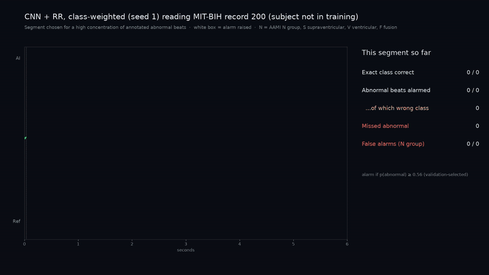

# ECG Arrhythmia Classification with a 1D CNN

A 1D convolutional network classifies heartbeats from the raw [MIT-BIH Arrhythmia Database](https://physionet.org/content/mitdb/1.0.0/) into the AAMI groups **N** (N group), **S** (supraventricular), **V** (ventricular) and **F** (fusion). The project's central question:

> **Does class-weighted cross-entropy raise per-class recall on the rare abnormal beats, compared with plain cross-entropy, when the model is tested on people it was not trained on?**

About 9 in 10 beats are in the N group, so accuracy says little. Every result is reported per class, with counts.

**What this is:** offline classification **at expert-annotated beat locations**. The cardiologists' annotations say where each beat is, and the model only decides what kind it is. There is no beat detection and no live monitoring (see [Limitations](#limitations)). Research project, not a medical device.



*Excerpt from the [full demo video](runs/strict_2026-11-08/demo_record_200.mp4) (31 s). Top: the model's predicted class (white outline = alarm raised). Middle: the cardiologists' reference label. Bottom: correct, missed or false alarm. The segment was chosen for its high concentration of abnormal beats; the video ends with whole-recording results.*

- Full walkthrough of the task, data, code and results: [WALKTHROUGH.md](WALKTHROUGH.md)
- Generated tables for the current run: [runs/strict_2026-11-08/summary.md](runs/strict_2026-11-08/summary.md)
- First version, kept as a labelled historical baseline: [historical/v1/](historical/v1/README.md)

## Evaluation protocol

| | Recordings | Beats (N / S / V / F) | Used for |
|---|---|---|---|
| Train | 16 DS1 recordings | 37,553 (33,751 / 742 / 2,676 / 384) | fitting weights |
| Validation | 6 DS1 recordings: 106, 122, 124, 205, 220, 223 | 13,420 (12,078 / 201 / 1,111 / 30) | early stopping, model choice, alarm threshold |
| **Strict test** | **21 DS2 recordings** (DS2 without 202) | 47,532 (42,163 / 1,782 / 3,200 / 387) | reporting only |

- **Subjects, not just recordings.** MIT-BIH has 48 recordings from 47 people: **201 and 202 are the same person.** The conventional de Chazal DS1/DS2 split puts 201 in DS1 and 202 in DS2, so it is not subject-disjoint. The **strict** split drops 202 from the test set: 22 DS1 recordings for development (16 train + 6 validation) and 21 test recordings, with no subject shared between any two partitions. An explicit record → subject map (`ecgcnn/data.py`) enforces this wherever partitions are built, and a unit test covers it.
- The **conventional** split (full DS2 including 202) is still reported for comparison, with this exception documented.
- The four paced recordings (102, 104, 107, 217) are excluded by AAMI convention.
- **Honesty note:** the DS2 test results had already been inspected during the first version of this project (see `historical/v1`). The revised evaluation fixes the split and moves every choice onto validation data, but DS2 is **not** a pristine, never-seen holdout.

Four configurations × seeds 0, 1, 2: **CNN/plain, CNN/weighted, CNN+RR/plain, CNN+RR/weighted.** Each model trains for up to 40 epochs. The checkpoint with the best **validation** macro-F1 is kept (patience 6). The test set is used only after training.

## Results: strict split, 21 test recordings, 3 seeds

Values are **mean ± sd across seeds** (training randomness), then a **95% patient-cluster bootstrap CI** in brackets (which patients happened to be tested: subjects resampled with replacement, 2,000 times). The two kinds of uncertainty are reported separately. Counts for every seed are in [summary.md](runs/strict_2026-11-08/summary.md).

### Per-class recall (4-class argmax: was the beat's exact class right?)

| Config | N group | S | V | F |
|---|---|---|---|---|
| CNN, plain | 87.9 ± 5.4 [79.9, 94.5] | 0.4 ± 0.2 [0.3, 1.7] | 90.4 ± 3.0 [80.1, 95.6] | 6.1 ± 10.6 [0.0, 7.7] |
| CNN, weighted | 82.4 ± 11.0 [75.6, 89.1] | 3.2 ± 1.8 [0.8, 16.0] | 83.5 ± 3.7 [68.0, 92.7] | 17.9 ± 26.2 [0.0, 18.8] |
| CNN+RR, plain | 86.0 ± 6.0 [77.2, 93.2] | 2.2 ± 1.5 [0.5, 10.7] | 92.2 ± 2.6 [82.7, 96.6] | 0.4 ± 0.7 [0.0, 0.5] |
| CNN+RR, weighted | 87.1 ± 3.7 [80.9, 93.1] | 3.4 ± 1.3 [0.6, 16.3] | 85.7 ± 6.4 [71.6, 93.5] | 12.1 ± 20.4 [0.0, 12.9] |

### Summary metrics

*Flag* = an S/V/F beat predicted as any non-N class, regardless of which. Flag recall is "did it raise *some* alarm?", which is a different question from "did it get the class right?".

| Config | Macro F1 | Balanced acc. | Flag recall | Flag precision | N-group false-positive rate |
|---|---|---|---|---|---|
| CNN, plain | 38.3 ± 1.0 [31.2, 44.2] | 46.2 ± 0.8 [43.1, 48.2] | 65.2 ± 1.8 [42.9, 88.8] | 42.5 ± 10.7 [23.4, 65.7] | 12.1 ± 5.4 [5.5, 20.1] |
| CNN, weighted | 38.5 ± 4.1 [33.2, 42.2] | 46.7 ± 4.5 [40.7, 50.9] | 62.2 ± 11.0 [39.8, 84.4] | 34.4 ± 10.4 [20.8, 47.6] | 17.6 ± 11.0 [10.9, 24.4] |
| CNN+RR, plain | 36.9 ± 3.1 [30.0, 43.0] | 45.2 ± 0.5 [42.5, 48.4] | 71.0 ± 14.0 [53.6, 89.0] | 40.4 ± 5.6 [22.0, 62.8] | 14.0 ± 6.0 [6.8, 22.8] |
| CNN+RR, weighted | 39.9 ± 2.4 [33.7, 44.6] | 47.1 ± 4.2 [41.9, 51.1] | 58.9 ± 6.2 [31.8, 85.4] | 37.4 ± 5.0 [21.0, 54.4] | 12.9 ± 3.7 [6.9, 19.1] |


### Answer to the class-weighting question

**Under this protocol, class weighting did not reliably improve rare-class recall.**

- **S** recall rose from 0.4% to 3.2% (CNN) and from 2.2% to 3.4% (CNN+RR). That is still near zero in every configuration, and the patient CIs overlap.
- **F** recall rose on average, but the seed-to-seed spread (±20–26 points) is larger than the change. F recall is at or below 5.4% in 9 of 12 runs. Seed 1 reaches 18% (CNN/plain), 48% (CNN/weighted) and 36% (CNN+RR/weighted), so the mean is driven by single seeds.
- **V** recall *fell*, from 90.4% to 83.5% (CNN) and from 92.2% to 85.7% (CNN+RR).
- Macro F1 and balanced accuracy differ by less than the seed spread.

This **contradicts the first version** of the project (v1: V recall 54% → 91% with weighting). Two things changed and could explain it, though neither was tested in isolation. First, v1 used one seed and a fixed 15 epochs. Second, here checkpoints are chosen by validation macro-F1, which already favours models that predict the minority classes, even without weights. Training also has 6 fewer recordings, because they now form the validation set.

**RR features** (beat-timing ratios) did not show a consistent advantage over CNN-only across seeds either.

### Validation-selected model and alarm threshold

The selection rule is: the configuration with the highest mean validation macro-F1 (**CNN+RR, weighted**), then its best validation seed (**seed 1**). Its alarm threshold is **0.56**, chosen on validation to maximise alarm F1 for *p_abnormal = 1 − p(N)*.

On the strict test set (47,532 beats):

| | Value | Counts |
|---|---|---|
| Exact class recall S / V / F | 4.4% / 80.8% / 35.7% | 78/1,782 · 2,587/3,200 · 138/387 |
| Alarm recall (p_abnormal ≥ 0.56) | 63.9% | 3,429 / 5,369 |
| Alarm precision | 37.7% | 3,429 / 9,097 |
| N-group false alarms | 13.4% | 5,668 / 42,163 |

These come from one seed and one validation partition. Results per test patient are in [summary.md](runs/strict_2026-11-08/summary.md). Record 232 alone holds 1,382 of the 1,782 S test beats, so S results mostly reflect one person.

## Interactive beat explorer

```bash
.venv/Scripts/streamlit run explorer.py --browser.gatherUsageStats false
```

What it does:
- Pick a checkpoint, including the historical v1 ones through the legacy loader, and a recording whose **subject** the model never saw in training or validation.
- Step through beats, or filter to **correct**, **wrong class**, **missed abnormal** and **false alarms**.
- For each beat, see the ±3 s context, the 504-sample model input, the reference and predicted class, the **model probabilities** (softmax outputs, not calibrated confidence) and the surrounding **RR intervals**.
- Whole-record results sit next to the beat view, with exact-class results and alarm results shown separately.
- **Alarm threshold slider** on *p_abnormal = 1 − p(N)*. This decision is separate from the 4-class argmax. The validation-selected default is shown, and any other value is labelled **exploratory** (chosen while looking at test data). A recall/precision-vs-threshold plot shows the trade-off.

Checkpoints load without retraining, and records and inference results are cached.

## Demo video

`runs/strict_2026-11-08/demo_record_200.mp4` shows the validation-selected model on record 200.
- The screen says the 20 s segment was **chosen for its high concentration of annotated abnormal beats**.
- **False alarms** and **missed beats** are labelled on each beat.
- Exact-class correctness and alarm correctness are counted separately.
- The closing card gives whole-recording results. On record 200 the model caught 825 of 857 abnormal beats but raised false alarms on 412 of 1,742 N-group beats (23.7%).

Videos (both also attached to the [GitHub release](../../releases) for direct download):
- [runs/strict_2026-11-08/demo_record_200.mp4](runs/strict_2026-11-08/demo_record_200.mp4): current version (validation-selected model, strict split)
- [historical/v1/results/demo_record_200.mp4](historical/v1/results/demo_record_200.mp4): v1 version, kept for reference (see [historical/v1](historical/v1/README.md) for its caveats)

```bash
.venv/Scripts/python demo.py --checkpoint runs/strict_2026-11-08/checkpoints/cnn+rr_weighted_seed1.pt --record 200
.venv/Scripts/python demo.py --checkpoint historical/v1/results/cnn+rr_unweighted.pt --legacy --record 200 --out v1_check.mp4
```

The demo refuses records whose subject is in the checkpoint's training or validation metadata (for example 202 for any model trained on 201). It needs `ffmpeg` on PATH.

## Reproduce

Tested on Windows 11, Python 3.13.7, RTX 3060 Ti. Versions are pinned in `requirements.txt`, and each run also records them in its `config.json`.

```bash
python -m venv .venv
.venv/Scripts/pip install torch==2.14.1 --index-url https://download.pytorch.org/whl/cu126   # CPU: pip install torch==2.14.1
.venv/Scripts/pip install -r requirements.txt
# download https://physionet.org/content/mitdb/1.0.0/ and unzip to data/mitdb
.venv/Scripts/python -m pytest                                        # 15 unit tests
.venv/Scripts/python run_experiments.py --out runs/my_run             # ~5 min on an RTX 3060 Ti; refuses to overwrite
.venv/Scripts/python summarize.py runs/my_run                         # writes runs/my_run/summary.md
```

Each run directory holds:
- `config.json`: records per partition, subject exceptions, hyperparameters, preprocessing, seeds and software versions.
- `metrics.json`: every metric, per seed and per patient, plus confusion matrices and bootstrap CIs.
- `checkpoints/*.pt`: weights plus architecture, class order, preprocessing, split, records, seed and threshold.
- `predictions/*.npz`: test-set probabilities.
- `train.log`, plots and `summary.md`.

CUDA training is seeded and set to deterministic mode where PyTorch supports it. Some kernels are still nondeterministic, so reruns can differ slightly.

## Code layout

| Path | Role |
|---|---|
| `ecgcnn/data.py` | record → subject map, splits, AAMI labels, RR features, window extraction, input validation |
| `ecgcnn/model.py` | 1D CNN, checkpoint save/load (with explicit `legacy=True` for v1 files), batched inference |
| `ecgcnn/train.py` | seeded training with validation early stopping |
| `ecgcnn/metrics.py` | confusion-based metrics (undefined → `None` + reason), alarm metrics, patient bootstrap |
| `ecgcnn/inference.py` | per-record inference, beat status, subject-based eligibility |
| `ecgcnn/plots.py` | plots from saved metrics |
| `run_experiments.py`, `summarize.py`, `demo.py`, `explorer.py` | command-line entry points / app |
| `tests/test_core.py` | subject separation, label mapping, RR features, metrics, checkpoint compatibility |

## Limitations

- **Annotated beat locations.** Beats are located from the cardiologists' annotations, not detected automatically.
- **RR features are offline.** They use the *next* beat and the *whole recording's* mean RR. Delaying the label on screen until the next beat arrives doesn't fix this: whole-record normalisation still uses future data, so the pipeline isn't suitable for live use as it stands.
- **N group ≠ normal sinus rhythm.** The AAMI N group includes bundle branch block (L, R) and escape beats (e, j).
- **Small, concentrated test classes.** S is dominated by record 232, and F by record 213 (362 of 387).
- **The validation partition is small and fixed** (30 F beats), so model and threshold selection are noisy. There is no cross-validation.
- **The random beat split (v1 only) is doubly optimistic.** It mixes beats from the same patient, and neighbouring 1.4 s windows overlap, so test windows contain samples seen in training.
- Research only, not a medical device.

## Optional extensions (not implemented, untested)

- **A. Patient-specific baseline:** compare each beat with a robust template built only from that patient's earlier, unlabelled beats, plus relative timing. Warm-up and update rules would have to avoid reference labels. Evaluate under the identical strict split.
- **B. Noise robustness:** add baseline wander, muscle and electrode-motion noise from the PhysioNet Noise Stress Test Database to held-out recordings. Its prepared noisy records are built from 118 and 119, which are *training* records here, so they can't count as unseen-patient test data.
- **C. Automatic beat detection:** a separate detected-peak mode, compared with annotation mode by counting missed and extra beats. An offline detector shouldn't be called streaming-ready unless that behaviour is tested.

## Licensing and attribution

- **Code:** no license chosen yet. Add a `LICENSE` file (for example MIT) before publishing if others should reuse it.
- **Data:** MIT-BIH is **not** included in this repository. It is distributed by PhysioNet under the [Open Data Commons Attribution License v1.0](https://physionet.org/content/mitdb/view-license/1.0.0/). Please cite:
  - Moody, G., & Mark, R. (2005). *MIT-BIH Arrhythmia Database* (version 1.0.0). PhysioNet. https://doi.org/10.13026/C2F305
  - Moody GB, Mark RG. *The impact of the MIT-BIH Arrhythmia Database.* IEEE Eng in Med and Biol 20(3):45-50 (2001).
  - The standard PhysioNet citation listed on the dataset page.
- **Methods referenced:** de Chazal, O'Dwyer & Reilly, *Automatic classification of heartbeats using ECG morphology and heartbeat interval features*, IEEE TBME 2004 (DS1/DS2 split) · Kachuee, Fazeli & Sarrafzadeh, *ECG Heartbeat Classification: A Deep Transferable Representation*, 2018, [arXiv:1805.00794](https://arxiv.org/abs/1805.00794) · [wfdb-python](https://github.com/MIT-LCP/wfdb-python)
