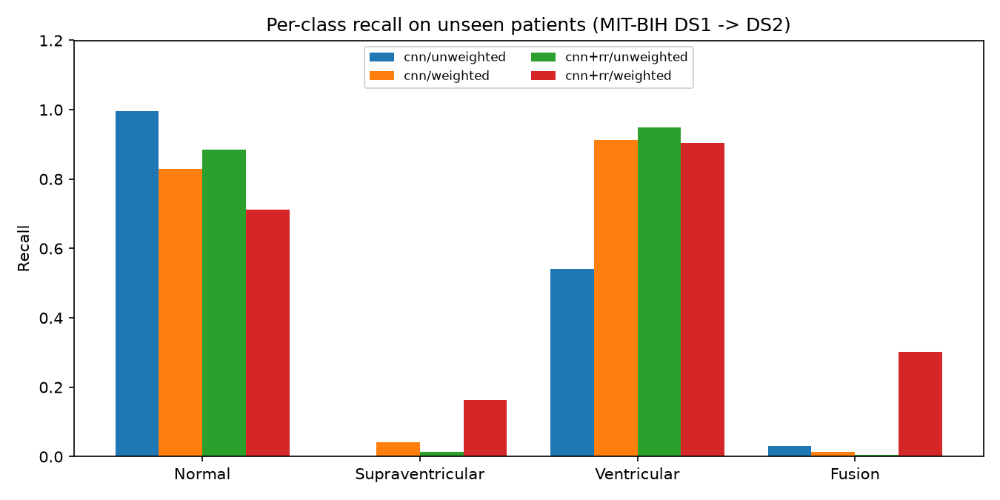
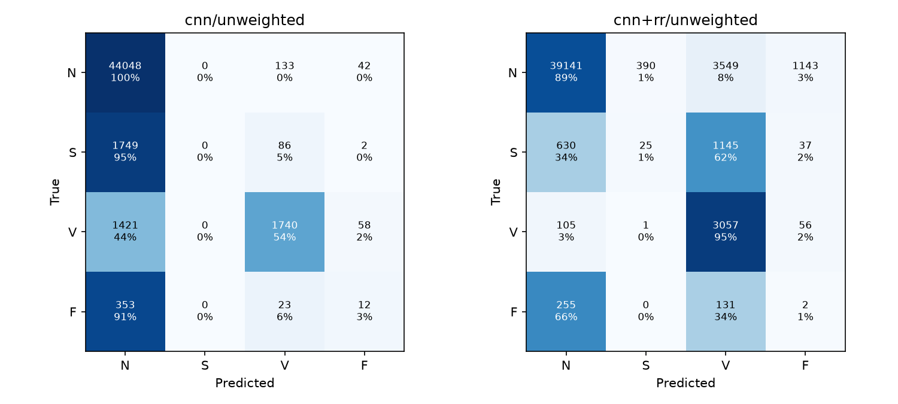

# ECG Arrhythmia Detection with a 1D CNN

A 1D convolutional network that reads raw ECG from the [MIT-BIH Arrhythmia Database](https://physionet.org/content/mitdb/1.0.0/) and classifies each heartbeat as **Normal (N)**, **Supraventricular (S)**, **Ventricular (V)** or **Fusion (F)**, following the AAMI EC57 grouping.

The main point of the project is evaluation. About 9 in 10 beats are normal, so accuracy tells you very little. Every result below reports **per-class recall**, and the headline numbers come from an **inter-patient split**: the model is tested on 22 people it never saw in training.

**Demo:** [`results/demo_record_200.mp4`](results/demo_record_200.mp4) shows the model reading an unseen patient's ECG beat by beat, with its prediction above each beat and the cardiologist's label below.

## Results

100,640 labelled beats from 44 recordings (the 4 paced records are excluded by AAMI convention).
*Flagged* = abnormal beats the model did not call normal. *False alarms* = normal beats the model called abnormal.

### Unseen patients (the honest number)

| Model | Loss | Accuracy | N | S | V | F | Flagged | False alarms |
|---|---|---|---|---|---|---|---|---|
| CNN | plain | 92.2% | 99.6% | **0.0%** | 54.1% | 3.1% | 35.3% | 0.4% |
| CNN | class-weighted | 80.0% | 83.0% | 4.1% | **91.3%** | 1.3% | **81.0%** | 17.0% |
| CNN + RR | plain | 85.0% | 88.5% | 1.4% | **95.0%** | 0.5% | **81.8%** | **11.5%** |
| CNN + RR | class-weighted | 70.1% | 71.2% | 16.3% | 90.5% | 30.2% | 70.2% | 28.8% |

### Random beat split (leaky: the same patients appear in train and test)

| Model | Loss | Accuracy | N | S | V | F |
|---|---|---|---|---|---|---|
| CNN | plain | 96.8% | 97.3% | 86.1% | 98.8% | 55.6% |
| CNN | class-weighted | 93.6% | 93.7% | 84.2% | 96.3% | 92.5% |
| CNN + RR | plain | 98.6% | 99.9% | 82.1% | 91.0% | 74.3% |
| CNN + RR | class-weighted | 85.5% | 84.3% | 96.9% | 96.7% | 86.7% |




### What this shows

1. **Accuracy misleads.** The plain CNN scores the highest accuracy (92%) on unseen patients and still finds no supraventricular beats and only half of the ventricular ones.
2. **Class weighting helps a lot.** With weighting, ventricular recall goes from **54% to 91%**, and the share of abnormal beats flagged goes from **35% to 81%**. The cost is that 17% of normal beats now raise a false alarm.
3. **RR-interval features reach the same flag rate with fewer false alarms:** 82% flagged at 11.5% false alarms, against 17% for weighted CNN-only. This is the model used in the demo.
4. **Splitting by beat inflates the score.** Supraventricular recall is 82–97% when the test patients were also in training, and 0–16% when they weren't. Many published MIT-BIH results use the leaky split.

### The open problem: supraventricular beats

Supraventricular beats look almost the same as normal beats. What sets them apart is mostly *timing*: they arrive early. I tried several fixes, comparing them on held-out *training* patients so the test set was never used to pick one:

- RR features fed into the CNN's final layer. 
- A separate RR branch whose output is added to the CNN's (late fusion).
- Fewer epochs and a smaller CNN.
- Averaging probabilities from a separately trained CNN and an RR-only logistic regression.

None of them got supraventricular recall above ~30% on the held-out training patients. The training set has only about 940 supraventricular beats, from a handful of patients, and the CNN memorises those patients' waveform shapes. One test patient, record 232, holds 1,382 of the 1,837 supraventricular test beats, so any test-set number for this class mostly reflects that one person. A fair next step would be patient-specific normalisation, for example comparing each beat to that patient's own average beat.

## Method

- **Loading:** `wfdb` reads each record's MLII lead (360 Hz) and the cardiologist beat annotations (`.atr`).
- **Windows:** 504 samples (±0.7 s) centred on each annotated R-peak, z-score normalised per window.
- **RR features (4):** previous RR, next RR and the mean of the last 10 RRs, each divided by the recording's mean RR, plus previous/next.
- **Labels:** N = {N, L, R, e, j}, S = {A, a, J, S}, V = {V, E}, F = {F}. Q / paced beats are dropped.
- **Split:** de Chazal et al. (2004) DS1 (22 patients, train) / DS2 (22 patients, test). The random beat split is a 70/30 stratified split, included only for comparison.
- **Model:** 4 × (Conv1d k=7 → BatchNorm → ReLU → MaxPool) with 32/64/128/128 channels, then global average pool, with the RR features concatenated, dropout and a linear layer (~190k params).
- **Training:** Adam (lr 1e-3), batch 256, 15 epochs, seed 0. The epoch count is fixed with no early stopping, so test patients are never used to choose a checkpoint.
- **Class weights:** sklearn `balanced` weights (inverse frequency) passed into `CrossEntropyLoss`.

Every configuration was trained once with a single seed, and GPU training is not bit-for-bit reproducible, so expect a few points of variation between runs.

## Run it

```bash
python -m venv .venv
.venv/Scripts/pip install torch --index-url https://download.pytorch.org/whl/cu126   # or plain `pip install torch` for CPU
.venv/Scripts/pip install -r requirements.txt
# download https://physionet.org/content/mitdb/1.0.0/ and unzip to data/mitdb
.venv/Scripts/python ecg.py              # all 8 experiments, ~4.5 min on an RTX 3060 Ti
.venv/Scripts/python demo.py 200         # render the demo video for any test record (needs ffmpeg)
```

Outputs, including the trained patient-split models (`*.pt`), go to `results/`.

## References

- Moody & Mark, *The impact of the MIT-BIH Arrhythmia Database*, IEEE EMB 2001. [PhysioNet](https://physionet.org/content/mitdb/1.0.0/)
- de Chazal, O'Dwyer & Reilly, *Automatic classification of heartbeats using ECG morphology and heartbeat interval features*, IEEE TBME 2004 (inter-patient split)
- Kachuee, Fazeli & Sarrafzadeh, *ECG Heartbeat Classification: A Deep Transferable Representation*, 2018. [arXiv:1805.00794](https://arxiv.org/abs/1805.00794)
- [wfdb-python](https://github.com/MIT-LCP/wfdb-python)
