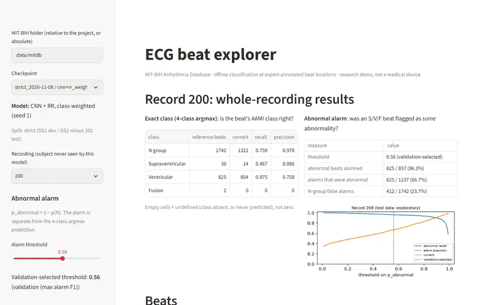
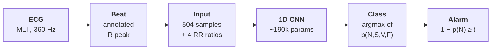
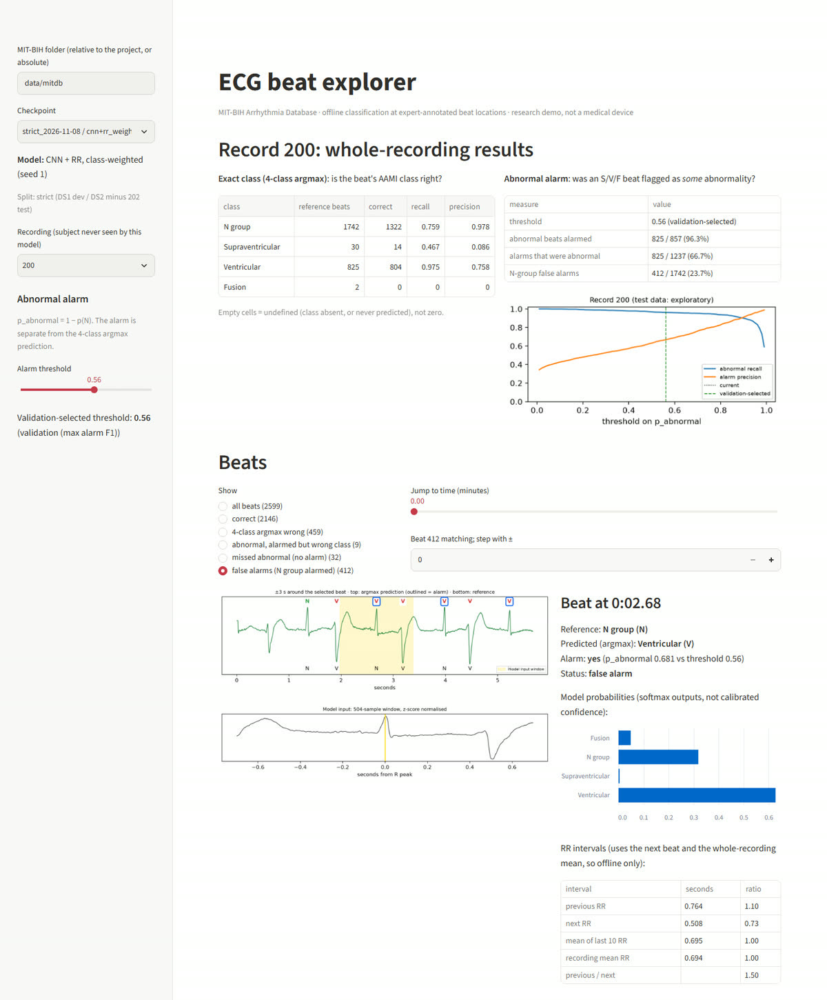
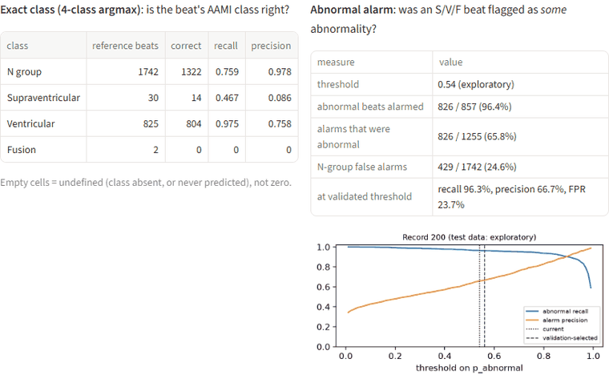
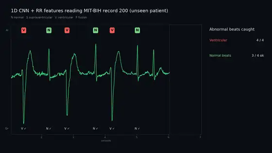
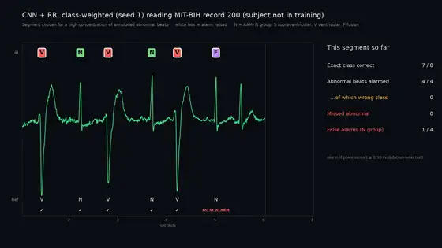
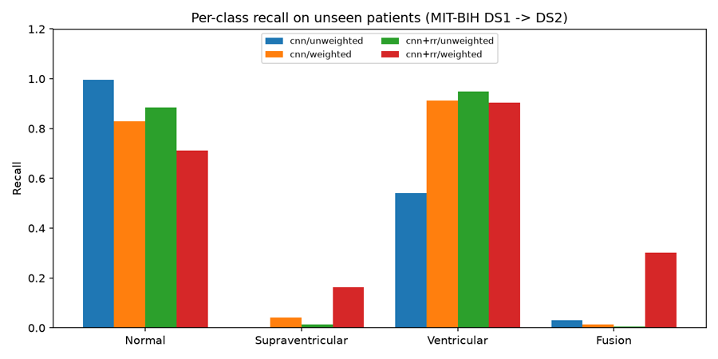
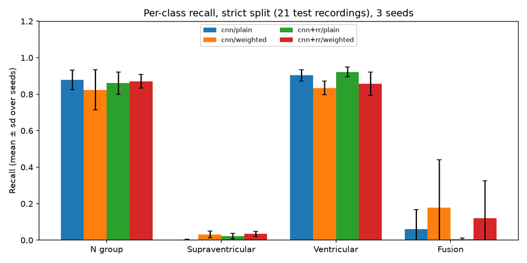

<div align="center">

# ECG Arrhythmia CNN

**A 1D CNN that classifies heartbeats from the MIT-BIH Arrhythmia Database into the AAMI N, S, V and F groups, tested on people it was not trained on**

[](https://github.com/IbaadGEO/ecg-arrhythmia-cnn/releases/tag/v2.0)    [](DATA-LICENCES.md) [](LICENSE) 

<a href="https://github.com/IbaadGEO/ecg-arrhythmia-cnn/releases/tag/v2.0"></a>

<sub>The beat explorer on record 200, a person the model never saw. Moving the alarm threshold off its validated value marks the results as exploratory; the filters then step through false alarms and missed beats. Full demo videos are on the release page.</sub>

</div>

## About

This project is part of a self-directed learning initiative across different fields, including coding, data, machine learning and geoscience projects. It is not a professional or commissioned study, and it is not a medical device. It uses only published, citable public data: the MIT-BIH Arrhythmia Database and its reference annotations. All results come from code and outputs in this repository, and the first version is kept with its errors documented in [historical/v1](historical/v1/README.md).

## Heartbeats, arrhythmias and the question

Each heartbeat on an electrocardiogram (ECG) produces a sharp QRS complex whose peak, the R peak, marks the beat's position. The MIT-BIH Arrhythmia Database holds 48 half-hour, two-channel ECG recordings from 47 subjects studied between 1975 and 1979. Initial beat labels were generated automatically, then two cardiologists independently reviewed each recording (Moody and Mark, 2001; Moody and Mark, 2005). The AAMI EC57 standard groups these beat labels into classes, including N, S (supraventricular ectopic), V (ventricular ectopic) and F (fusion) (AAMI, 2012).

About 9 in 10 beats are in the N group, so a model that always answers N scores about 90% accuracy and finds nothing. de Chazal, O'Dwyer and Reilly (2004) split the 44 non-paced recordings into two sets of 22 (DS1 and DS2) so that classifiers are tested on recordings they never trained on. Their statistical classifier reached 75.9% sensitivity and 38.5% positive predictivity for S beats. Records 201 and 202 come from the same subject, so for subject-independent evaluation they belong in the same partition (Moody and Mark, 2005). The conventional DS1/DS2 split puts them on opposite sides.

**The question this project tests:** does class-weighted cross-entropy raise per-class recall on the rare S, V and F beats, compared with plain cross-entropy, for people the model was not trained on?



The pipeline classifies beats at the annotated positions. It does not detect beats itself and it does not run live: the RR features use the next beat and the whole recording's mean RR interval.

## What the project does



- **Trains and compares four configurations** (CNN or CNN + RR features, with plain or class-weighted loss), each with seeds 0, 1 and 2, on 16 training recordings. Early stopping, model choice and the alarm threshold use 6 validation recordings.
- **Tests on 21 recordings (47,532 beats)** whose subjects never appear in training or validation. An explicit record-to-subject map enforces this, and a unit test covers it.
- **Reports each class separately, with counts.** That covers recall, precision and F1 per class, macro F1, balanced accuracy, abnormal-flag recall and precision, the N-group false-alarm rate and results per test patient.
- **Separates two kinds of uncertainty:** the spread across seeds, and 95% confidence intervals from resampling test patients, 2,000 times.
- **Explorer app:** opens any of the 16 saved checkpoints (12 from the current run, 4 from v1) on any recording its model never saw. You can step through beats, filter by outcome, and see each beat's probabilities and RR intervals. On record 200 the selected model raises 412 false alarms and misses 32 abnormal beats; the filters list each one.

### The alarm threshold, explored on one recording



Record 200, threshold swept from 0.30 to 0.90. The alarm fires when *1 − p(N)* reaches the threshold, separately from the 4-class prediction. The validated threshold is 0.56, chosen on the validation recordings; at it, 825 of 857 abnormal beats are alarmed and 412 of 1,742 N-group beats raise false alarms (23.7%). Other values are exploratory because they are chosen while looking at test data.

## Results

Strict split, 21 test recordings, 3 seeds. Values are **mean ± sd across seeds**, then the **95% patient-cluster bootstrap CI** in brackets. Generated tables with every count are in [runs/strict_2026-11-08/summary.md](runs/strict_2026-11-08/summary.md).

| Config | N group | S | V | F |
|---|---|---|---|---|
| CNN, plain | 87.9 ± 5.4 [79.9, 94.5] | 0.4 ± 0.2 [0.3, 1.7] | 90.4 ± 3.0 [80.1, 95.6] | 6.1 ± 10.6 [0.0, 7.7] |
| CNN, weighted | 82.4 ± 11.0 [75.6, 89.1] | 3.2 ± 1.8 [0.8, 16.0] | 83.5 ± 3.7 [68.0, 92.7] | 17.9 ± 26.2 [0.0, 18.8] |
| CNN+RR, plain | 86.0 ± 6.0 [77.2, 93.2] | 2.2 ± 1.5 [0.5, 10.7] | 92.2 ± 2.6 [82.7, 96.6] | 0.4 ± 0.7 [0.0, 0.5] |
| CNN+RR, weighted | 87.1 ± 3.7 [80.9, 93.1] | 3.4 ± 1.3 [0.6, 16.3] | 85.7 ± 6.4 [71.6, 93.5] | 12.1 ± 20.4 [0.0, 12.9] |

<sub>Per-class recall (%), 4-class argmax.</sub>

**Answer: class weighting did not reliably improve rare-class recall under this protocol.** S recall stayed below 4% on average in every configuration. F recall rose on average, but 9 of the 12 runs scored 5.4% or less and the mean is driven by seed 1. V recall fell by about 7 points with weighting. RR features showed no consistent advantage either.

The validation-selected model (CNN + RR, class-weighted, seed 1, threshold 0.56) alarmed on 3,429 of 5,369 abnormal test beats (63.9%). 3,429 of its 9,097 alarms were real (37.7%), and 5,668 of 42,163 N-group beats raised false alarms (13.4%).

### First version against the current one

Both demo excerpts show the same stretch of record 200 (966–974 s).

<table>
<tr>
<td width="50%"><br><b>v1 demo.</b> CNN + RR, plain loss, trained on all 22 DS1 recordings with one seed and no validation set. Over the whole of record 200 it flags 816 of 857 abnormal beats and 162 of 1,742 N-group beats (9.3%). It does not label false alarms on screen.</td>
<td width="50%"><br><b>v2 demo.</b> The validation-selected model at threshold 0.56. Over the whole recording it alarms on 825 of 857 abnormal beats and on 412 of 1,742 N-group beats (23.7%). Every false alarm and miss is labelled. One recording does not compare the two protocols.</td>
</tr>
<tr>
<td><br><b>v1 recall.</b> One seed. The patient split is the conventional DS1/DS2, which shares subject 201/202; the beat split mixes beats from the same patients and overlapping windows.</td>
<td><br><b>v2 recall.</b> Strict split, mean ± sd over 3 seeds. The v1 result "weighting raises V recall from 54% to 91%" does not reappear.</td>
</tr>
</table>

<sub>ECG and reference labels: MIT-BIH Arrhythmia Database, record 200 (Moody and Mark, 2005), ODC-By 1.0. Excerpts cut from the demo videos and re-encoded as animated WebP at 8 fps.</sub>

## Third-party material

Every ECG trace and reference label shown in this repository comes from the MIT-BIH Arrhythmia Database (Moody and Mark, 2005), under the Open Data Commons Attribution License v1.0. The recordings themselves are not included; you download them from PhysioNet. The README media are screen recordings of this project's explorer, excerpts of its demo videos and its own plots. They were cropped, resized, re-timed and re-encoded as WebP, GIF, JPEG and PNG. No other authors' figures or outputs are reproduced.

## Observed, reported or estimated

| Part | Status | Source |
|---|---|---|
| ECG signals, MLII lead, 360 Hz | Observed (recorded 1975–1979) | Moody and Mark (2001, 2005) |
| Beat positions and beat labels | Reported (automatic labels, reviewed by two cardiologists) | Moody and Mark (2005) |
| Records 201 and 202 from the same subject | Reported | Moody and Mark (2005) |
| N, S, V, F grouping of the labels | Standard, applied by this project | AAMI (2012) |
| Beat windows and RR-interval features | **Derived** by this project | `ecgcnn/data.py` |
| Model probabilities, predictions and alarms | **Model output** | this project |
| Recall, precision, F1, flag metrics, per-patient results | **Computed** against the reference labels | this project |
| Confidence intervals | **Estimated** (patient-cluster bootstrap) | this project |
| Alarm threshold 0.56 and the selected model | **Chosen** on validation recordings | this project |

## Built with

- **Model and training:** Python 3.13, PyTorch 2.14 (CUDA 12.6), NumPy, scikit-learn for class weights.
- **Data access:** wfdb 4.3.1 to read the PhysioNet records and annotations.
- **Evaluation and plots:** custom confusion-matrix metrics and patient bootstrap, matplotlib.
- **Explorer and video:** Streamlit 1.67, matplotlib with ffmpeg; README media recorded with Playwright (headless Chromium) and assembled with Pillow and ffmpeg.
- **Tests:** pytest, 15 tests covering subject separation, label mapping, RR features, metrics and checkpoint loading.

Full walkthrough of the code and protocol: [WALKTHROUGH.md](WALKTHROUGH.md) · v1 baseline and its corrections: [historical/v1/README.md](historical/v1/README.md) · Terms per file: [DATA-LICENCES.md](DATA-LICENCES.md)

## References

**Research papers**

- de Chazal, P., O'Dwyer, M. and Reilly, R.B. (2004) 'Automatic classification of heartbeats using ECG morphology and heartbeat interval features', *IEEE Transactions on Biomedical Engineering*, 51(7), pp. 1196–1206. doi:10.1109/TBME.2004.827359.
- Kachuee, M., Fazeli, S. and Sarrafzadeh, M. (2018) 'ECG heartbeat classification: a deep transferable representation', *2018 IEEE International Conference on Healthcare Informatics (ICHI)*, pp. 443–444. doi:10.1109/ICHI.2018.00092.
- Moody, G.B. and Mark, R.G. (2001) 'The impact of the MIT-BIH Arrhythmia Database', *IEEE Engineering in Medicine and Biology Magazine*, 20(3), pp. 45–50. doi:10.1109/51.932724.

**Data and standards**

- AAMI (2012) *ANSI/AAMI EC57:2012 Testing and reporting performance results of cardiac rhythm and ST segment measurement algorithms* (reaffirmed 2020). Arlington, VA: Association for the Advancement of Medical Instrumentation. doi:10.2345/9781570204784.
- Moody, G. and Mark, R. (2005) *MIT-BIH Arrhythmia Database* (version 1.0.0). PhysioNet. doi:10.13026/C2F305.
- Pollard, T., Moody, B.E., Lehman, L.H., Gow, B.J., Fernandes, C., Xie, C., Johnson, A., Mark, R.G. and Heldt, T. (2026) 'PhysioNet as a global platform for biomedical research', *Nature Health*, 1(8), pp. 792–795. doi:10.1038/s44360-026-00096-z.

**Software**

- Paszke, A. et al. (2019) 'PyTorch: an imperative style, high-performance deep learning library', *Advances in Neural Information Processing Systems 32 (NeurIPS 2019)*. arXiv:1912.01703, doi:10.48550/arXiv.1912.01703.
- Pedregosa, F. et al. (2011) 'Scikit-learn: machine learning in Python', *Journal of Machine Learning Research*, 12(85), pp. 2825–2830.
- Xie, C., McCullum, L., Johnson, A., Pollard, T., Gow, B. and Moody, B. (2023) *Waveform Database Software Package (WFDB) for Python* (version 4.1.0). PhysioNet. doi:10.13026/9njx-6322. (Version 4.3.1 from PyPI was used.)

Accessed 9 November 2026. Kachuee, Fazeli and Sarrafzadeh (2018) is the source of the pre-segmented Kaggle version of MIT-BIH. It was not used here because its rows hold 187 samples and a label but no record identifier, so it cannot be split by patient.

<details>
<summary><b>Run it, retrain or rebuild the media</b></summary>

### Install

Tested on Windows 11 with Python 3.13.7 and an RTX 3060 Ti. Versions are pinned in `requirements.txt`.

```bash
python -m venv .venv
.venv/Scripts/pip install torch==2.14.1 --index-url https://download.pytorch.org/whl/cu126   # CPU: pip install torch==2.14.1
.venv/Scripts/pip install -r requirements.txt
```

One input must be placed by hand: download the MIT-BIH Arrhythmia Database v1.0.0 from https://physionet.org/content/mitdb/1.0.0/ and unzip it so the record files sit in `data/mitdb/` (for example `data/mitdb/100.hea`, `100.dat`, `100.atr`).

### Explore the saved models (no training needed)

```bash
.venv/Scripts/streamlit run explorer.py --browser.gatherUsageStats false
```

### Retrain and evaluate

```bash
.venv/Scripts/python -m pytest                                  # 15 unit tests
.venv/Scripts/python run_experiments.py --out runs/my_run       # 4 configs x 3 seeds, about 5 min on an RTX 3060 Ti
.venv/Scripts/python summarize.py runs/my_run                   # writes runs/my_run/summary.md
```

`run_experiments.py` refuses to overwrite an existing run directory. Each run records its records per partition, seeds, hyperparameters and software versions in `config.json`. CUDA training is seeded and set to deterministic mode where PyTorch allows it; some kernels remain nondeterministic, so reruns can differ slightly.

### Render a demo video

Needs `ffmpeg` on PATH. The script refuses any recording whose subject the checkpoint saw in training or validation.

```bash
.venv/Scripts/python demo.py --checkpoint runs/strict_2026-11-08/checkpoints/cnn+rr_weighted_seed1.pt --record 200
.venv/Scripts/python demo.py --checkpoint historical/v1/results/cnn+rr_unweighted.pt --legacy --record 200 --out v1_check.mp4
```

### Code layout

| Path | Role |
|---|---|
| `ecgcnn/data.py` | record-to-subject map, splits, AAMI labels, RR features, windows, input checks |
| `ecgcnn/model.py` | 1D CNN, self-describing checkpoints, explicit `legacy=True` loading for v1 files |
| `ecgcnn/train.py` | seeded training with validation early stopping |
| `ecgcnn/metrics.py` | confusion-matrix metrics (undefined values kept as undefined), alarm metrics, patient bootstrap |
| `ecgcnn/inference.py` | per-record inference, beat status, subject-based eligibility |
| `run_experiments.py`, `summarize.py`, `demo.py`, `explorer.py` | entry points |

### Limitations

- Beat positions come from the reference annotations; there is no beat detector.
- RR features use the next beat and the whole-recording mean, so the pipeline is offline only.
- The AAMI N group includes bundle branch block and escape beats, so it is broader than normal sinus rhythm.
- The validation partition is small and fixed (30 F beats). There is no cross-validation.
- Test classes are concentrated: record 232 holds 1,382 of 1,782 S beats, and record 213 holds 362 of 387 F beats.
- DS2 results had been inspected during v1, so DS2 is not an untouched holdout.

</details>

## Licence

Code: [MIT](LICENSE). The ECG data and reference labels keep the MIT-BIH Arrhythmia Database's terms (Open Data Commons Attribution License v1.0); see [DATA-LICENCES.md](DATA-LICENCES.md). The animations and images in `docs/media/` are recordings and excerpts of this project's outputs that show MIT-BIH data, shared under the same attribution terms.
