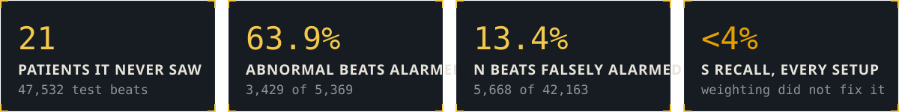
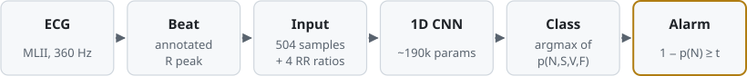
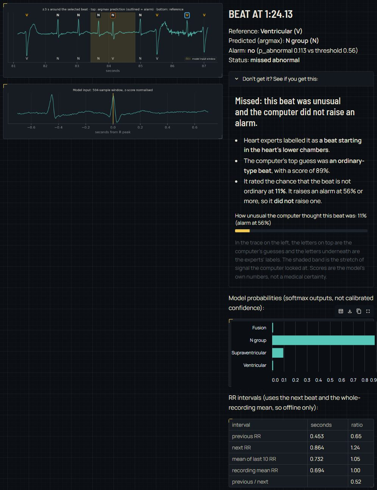
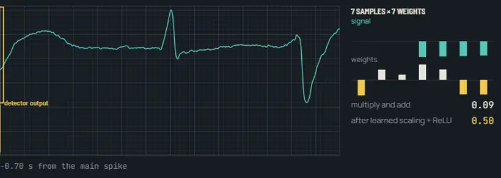

<div align="center">


[](https://ecg-beat-explorer.streamlit.app) [](https://github.com/IbaadGEO/ecg-arrhythmia-cnn/releases/tag/v2.0)    [](DATA-LICENCES.md) [](LICENSE)

**[Open the live explorer ↗](https://ecg-beat-explorer.streamlit.app)** · **[The question](#the-question)** · **[The explorer](#the-explorer)** · **[Inside the model](#inside-the-model)** · **[Results](#results)** · **[v1 against v2](#v1-against-v2)** · **[Run it](#run-it)**



</div>

> [!NOTE]
> This is a personal learning project covering coding, data, machine learning and geoscience, not commissioned research or a professional study. It is **not a medical device**. I used published MIT-BIH Arrhythmia Database recordings and reference annotations. The results can be traced to the code and outputs in this repository. I have also kept the original version, including its documented mistakes, in [historical/v1](historical/v1/README.md).

<div align="center">


<sub>The explorer replays record 200, from a subject the model did not train on. A prediction appears only after the full ECG window and following beat are available. Outlined labels show alarms; the panel tracks correct predictions, misses and false alarms.</sub>

</div>

## The question

<table>
<tr>
<td width="50%" valign="top">

**The data.** An ECG records the heart's electrical activity. Each beat has a QRS complex, with its R peak marking the beat position. The MIT-BIH Arrhythmia Database contains 48 half-hour, two-channel recordings from 47 subjects, collected between 1975 and 1979. Two cardiologists independently reviewed the automatic beat annotations (Moody and Mark, 2001; 2005). Following AAMI EC57, I group them into N, S (supraventricular ectopic), V (ventricular ectopic) and F (fusion) (AAMI, 2012).

</td>
<td width="50%" valign="top">

**The problem.** Around 9 in 10 beats belong to N. Predicting N every time therefore gives roughly 90% accuracy without identifying abnormal beats. de Chazal, O'Dwyer and Reilly (2004) divided the 44 non-paced recordings into DS1 and DS2 to test on unseen recordings and reported 75.9% sensitivity and 38.5% positive predictivity for S beats. Their split still places records 201 and 202, which belong to the same subject, on opposite sides (Moody and Mark, 2005).

</td>
</tr>
</table>

> [!IMPORTANT]
> **Does class-weighted cross-entropy improve recall for the less common S, V and F beats, compared with standard cross-entropy, when tested on subjects the model has never seen?**

<picture>
  <source media="(prefers-color-scheme: dark)" srcset="docs/media/flow-dark.svg">
  
</picture>

| | |
|---|---|
| **Train** | 4 configurations (CNN or CNN + RR features, plain or class-weighted loss) × seeds 0, 1, 2, on 16 recordings. Early stopping, model choice and the alarm threshold use 6 validation recordings. |
| **Test** | 21 recordings, 47,532 beats, from subjects never seen in training or validation. A record-to-subject map enforces this, and a unit test covers it. |
| **Report** | Recall, precision and F1 per class, macro F1, balanced accuracy, abnormal-flag recall and precision, N-group false-alarm rate and per-patient results, all with counts. |
| **Uncertainty** | Spread across seeds, and 95% intervals from resampling test patients 2,000 times. |
| **Scope** | Beats are classified at the annotated positions; there is no beat detector. RR features use the next beat and the recording's mean RR, so the pipeline is offline. The explorer's monitor replays in real time, but each label still waits for the next beat. |

## The explorer

The **[live Streamlit explorer](https://ecg-beat-explorer.streamlit.app)** loads 16 saved checkpoints (12 current, 4 from v1) and recordings from subjects unseen by the selected model. You can inspect each prediction and how it was calculated, or run the app locally (see [Run it](#run-it)).


| You choose | You get |
|---|---|
| Data folder, checkpoint, recording, alarm threshold | Only recordings whose subject the chosen model never saw. Missing recordings download from PhysioNet on first use. |
| A threshold | Whole-record tables and a recall and precision against threshold chart. 0.56 is the validated value; anything else is marked exploratory. |
| A beat filter | All, correct, wrong 4-class guess, alarm with the wrong type, missed abnormal, false alarm, each with its count. A time slider and a counter step through them. |
| A beat | ±3 s of context with predicted labels above and reference labels below, the 504-sample model input, probabilities, RR intervals in seconds and as ratios. |
| *A simpler explanation* | The same beat in everyday words: a one-line verdict, the experts' label against the model's top guess, and a bar showing how unusual the model rated it against the alarm line. |

<table>
<tr>
<td width="55%" valign="top"><br><b>Alarm threshold.</b> The alarm uses <i>1 − p(N)</i> independently of the 4-class prediction. At threshold 0.56 on record 200, it flags 825 of 857 abnormal beats but also 412 of 1,742 N-group beats (23.7% false alarms).</td>
<td width="45%" valign="top"><br><b>A missed V beat.</b> The explorer gives both the model's detailed output and a simpler explanation. It uses the word <i>scores</i>, not <i>confidence</i>, because the softmax outputs are not calibrated.</td>
</tr>
</table>

The dark interface has a faint ECG-paper grid and simple panels. Class colours use the colour-blind-friendly Okabe–Ito palette: N off-white, S sky blue, V orange and F reddish purple. Models without RR features hide the timing explanations. Because v1 has no validated alarm threshold, those checkpoints default to 0.50 with a warning.

## Inside the model

The final section explains the selected beat using a 20 s replay and five steps through the network. Each animation uses the checkpoint's actual weights and activations, with controls for editing the input and seeing how the prediction changes.

<table>
<tr>
<td width="50%"><br><b>Pattern detectors.</b> You can follow any of the 32 first-layer filters across the 504-sample ECG window. The diagram shows its 7 input samples, 7 learned weights and output after scaling and ReLU. A separate 7-slider example lets you build your own filter.</td>
<td width="50%"><br><b>Bigger patterns.</b> Heatmaps show the four convolution blocks reducing the input from 504 to 252, 126, 63 and 31 time positions. The final outputs are averaged into 128 features. You can select any one and see where it responds along the beat and how it contributes to each class score.</td>
</tr>
<tr>
<td><br><b>The decision.</b> Each class score is broken down into the 128 shape features, 4 RR timing features and a bias before softmax converts it into a percentage. You can remove the shape or timing contribution from the calculation and compare the exact score components in a table.</td>
<td><br><b>What it relies on.</b> The app flattens one section of the ECG at a time and plots how the output changes. In the example of a missed V beat, the abnormal score remains well below the alarm threshold. Another sweep varies the preceding RR interval from 0.3× to 2× the average. You can try both changes manually.</td>
</tr>
</table>

The *What goes in* step shows the 1.4 s window being extracted and normalised. Changes to height and baseline disappear after normalisation, while moving the window changes the input. Edited beats are artificial tests of the model, not evidence about heart behaviour. All diagrams have play and replay controls and respect reduced-motion settings.

## Results

Results use the strict subject-separated split: 21 test recordings and 3 seeds. The table reports mean ± standard deviation across seeds, with 95% patient-cluster bootstrap confidence intervals in brackets. Values are 4-class argmax recall (%) by class. Full counts are in [runs/strict_2026-11-08/summary.md](runs/strict_2026-11-08/summary.md).

| Config | N group | S | V | F |
|---|---|---|---|---|
| CNN, plain | 87.9 ± 5.4 [79.9, 94.5] | 0.4 ± 0.2 [0.3, 1.7] | 90.4 ± 3.0 [80.1, 95.6] | 6.1 ± 10.6 [0.0, 7.7] |
| CNN, weighted | 82.4 ± 11.0 [75.6, 89.1] | 3.2 ± 1.8 [0.8, 16.0] | 83.5 ± 3.7 [68.0, 92.7] | 17.9 ± 26.2 [0.0, 18.8] |
| CNN+RR, plain | 86.0 ± 6.0 [77.2, 93.2] | 2.2 ± 1.5 [0.5, 10.7] | 92.2 ± 2.6 [82.7, 96.6] | 0.4 ± 0.7 [0.0, 0.5] |
| CNN+RR, weighted | 87.1 ± 3.7 [80.9, 93.1] | 3.4 ± 1.3 [0.6, 16.3] | 85.7 ± 6.4 [71.6, 93.5] | 12.1 ± 20.4 [0.0, 12.9] |

> [!IMPORTANT]
> **Class weighting did not consistently improve recall for the rare classes.** Average S recall stayed below 4% in every setup. F recall increased on average, but 9 of 12 runs reached only 5.4% or less, with seed 1 driving the mean. Weighting reduced V recall by around 7 points, and adding RR features gave no consistent improvement.

The model chosen on validation data (CNN + RR, class-weighted, seed 1; threshold 0.56) flagged 3,429 of 5,369 abnormal test beats (63.9%). Of 9,097 alarms, 3,429 were true abnormal beats (37.7%). It falsely flagged 5,668 of 42,163 N-group beats (13.4%).

## v1 against v2

Both demos use the same section of record 200 (966–974 s). Full videos are in the [v2.0 release](https://github.com/IbaadGEO/ecg-arrhythmia-cnn/releases/tag/v2.0); they were recorded before the current explorer theme.

<table>
<tr>
<td width="50%"><br><b>v1 demo.</b> CNN + RR with plain loss, trained on all 22 DS1 recordings with one seed and no validation set. On record 200 it flagged 816 of 857 abnormal beats and 162 of 1,742 N-group beats (9.3%). False alarms were not identified on screen.</td>
<td width="50%"><br><b>v2 demo.</b> The validation-selected model at threshold 0.56 flagged 825 of 857 abnormal beats and 412 of 1,742 N-group beats (23.7%) in record 200. Misses and false alarms are shown. One recording is not enough for a fair comparison between the protocols.</td>
</tr>
<tr>
<td><br><b>v1 recall.</b> Results come from one seed. The conventional DS1/DS2 split includes subject overlap between records 201 and 202. The beat-level split also mixes beats from the same patients, including overlapping windows.</td>
<td><br><b>v2 recall.</b> Strict subject-separated split, mean ± standard deviation over 3 seeds. The v1 finding that weighting increased V recall from 54% to 91% did not hold.</td>
</tr>
</table>

<sub>ECG signals and reference labels come from MIT-BIH record 200 (Moody and Mark, 2005), under ODC-By 1.0. The excerpts were taken from `demo.py` videos and converted to animated WebP at 8 fps. `demo.py` retains its own video layout.</sub>

## Where each part comes from

| Part | Status | Source |
|---|---|---|
| ECG signals, MLII lead, 360 Hz | Observed (recorded 1975–1979) | Moody and Mark (2001, 2005) |
| Beat positions and beat labels | Reported (automatic labels, reviewed by two cardiologists) | Moody and Mark (2005) |
| Records 201 and 202 from the same subject | Reported | Moody and Mark (2005) |
| N, S, V, F grouping of the labels | Standard, applied by this project | AAMI (2012) |
| Beat windows and RR-interval features | Derived by this project | `ecgcnn/data.py` |
| Model probabilities, predictions and alarms | Model output | this project |
| Filter outputs, layer activations and score parts in the explorer | Model internals, read from the checkpoint | `ecgcnn/explain.py` |
| Answers for flattened, shifted or re-timed beats | Model output on edited inputs, not recordings | `ecgcnn/explain.py` |
| Recall, precision, F1, flag metrics, per-patient results | Computed against the reference labels | this project |
| Confidence intervals | Estimated (patient-cluster bootstrap) | this project |
| Alarm threshold 0.56 and the selected model | Chosen on validation recordings | this project |

All ECG signals and reference labels, including those in the banner, are from the MIT-BIH Arrhythmia Database (Moody and Mark, 2005), licensed under Open Data Commons Attribution License v1.0. Recordings are not bundled and are downloaded from PhysioNet. README media consist of this project's explorer recordings, demo excerpts, plots and diagrams, edited and exported as WebP, JPEG, PNG and SVG. No figures or outputs from other authors are reproduced.

Fonts are stored in `static/fonts/`, each with its SIL Open Font License 1.1 file: [Manrope](https://github.com/sharanda/manrope) (The Manrope Project Authors), [Barlow Semi Condensed](https://github.com/jpt/barlow) (The Barlow Project Authors) and [JetBrains Mono](https://github.com/JetBrains/JetBrainsMono) (The JetBrains Mono Project Authors). The banner and figures strip embed Barlow Semi Condensed and JetBrains Mono.

## Run it

The [live explorer](https://ecg-beat-explorer.streamlit.app) loads saved checkpoints without retraining. The instructions below cover installation, local use, hosting, retraining, demo videos and the code layout.

Code and protocol: [WALKTHROUGH.md](WALKTHROUGH.md) · v1 results and corrections: [historical/v1/README.md](historical/v1/README.md) · File licences: [DATA-LICENCES.md](DATA-LICENCES.md)

<details>
<summary><b>Install, run, retrain, render</b></summary>

### Install

I tested this on Windows 11 with Python 3.13.7 and an RTX 3060 Ti. Dependencies are pinned in `requirements.txt`. Linux installs CPU-only PyTorch by default. For Linux GPU training, install the CUDA build first and remove the `+cpu` line.

```bash
python -m venv .venv
.venv/Scripts/pip install torch==2.14.1 --index-url https://download.pytorch.org/whl/cu126   # CPU: pip install torch==2.14.1
.venv/Scripts/pip install -r requirements.txt
```

Training requires the complete [MIT-BIH Arrhythmia Database v1.0.0](https://physionet.org/content/mitdb/1.0.0/). Extract it to `data/mitdb/`, with files such as `data/mitdb/100.hea`, `100.dat` and `100.atr`. For the explorer, this download is optional: missing records are fetched from PhysioNet on demand (three files, about 2 MB per record).

### Explore the saved models (no training needed)

Run this from the repository root so Streamlit loads `.streamlit/config.toml` (theme, fonts and usage statistics disabled):

```bash
.venv/Scripts/streamlit run explorer.py
```

Restart Streamlit after changing `ecgcnn/` files, as imported modules remain in memory.

### Host the explorer on Streamlit Community Cloud (free)

The live app uses Streamlit Community Cloud. Saved checkpoints are included in the repository; missing recordings download on first use; Linux uses CPU-only PyTorch; and theme files load from `.streamlit/config.toml` and `static/`. To host it yourself, create an app at share.streamlit.io from the `main` branch, choose `explorer.py` and select Python 3.13 if available.

The free tier provides roughly 0.7–2.7 GB RAM. The explorer used about 0.75 GB locally and caches up to 4 recordings. Apps sleep after 12 hours without visitors and resume on the next visit. A new recording takes a few seconds to download.

### Retrain and evaluate

```bash
.venv/Scripts/python -m pytest                                  # 28 unit tests
.venv/Scripts/python run_experiments.py --out runs/my_run       # 4 configs x 3 seeds, about 5 min on an RTX 3060 Ti
.venv/Scripts/python summarize.py runs/my_run                   # writes runs/my_run/summary.md
```

`run_experiments.py` will not overwrite an existing run. Each run saves partition membership, seeds, hyperparameters and software versions to `config.json`. CUDA training is seeded and deterministic where supported, but some PyTorch kernels can still produce small differences between runs.

### Render a demo video

Requires `ffmpeg` on PATH. The script rejects recordings from subjects present in the checkpoint's training or validation data.

```bash
.venv/Scripts/python demo.py --checkpoint runs/strict_2026-11-08/checkpoints/cnn+rr_weighted_seed1.pt --record 200
.venv/Scripts/python demo.py --checkpoint historical/v1/results/cnn+rr_unweighted.pt --legacy --record 200 --out v1_check.mp4
```

### Code layout

| Path | Role |
|---|---|
| `ecgcnn/data.py` | record-to-subject map, splits, AAMI labels, RR features, windows, input checks, on-demand record download |
| `ecgcnn/model.py` | 1D CNN, self-describing checkpoints, explicit `legacy=True` loading for v1 files |
| `ecgcnn/train.py` | seeded training with validation early stopping |
| `ecgcnn/metrics.py` | confusion-matrix metrics (undefined values kept as undefined), alarm metrics, patient bootstrap |
| `ecgcnn/inference.py` | per-record inference, beat status, subject-based eligibility |
| `ecgcnn/explain.py` | layer outputs, exact score split, edited-input sweeps and plain-language summaries for the explorer |
| `ecgcnn/live.js` | the explorer's animated canvas diagrams |
| `.streamlit/config.toml`, `observatory.mplstyle`, `static/fonts/` | explorer theme, matching plot style, self-hosted fonts |
| `run_experiments.py`, `summarize.py`, `demo.py`, `explorer.py` | entry points |

### Limitations

- Beat locations use reference annotations. The project does not detect beats independently.
- RR features depend on the next beat and whole-recording mean, so classification is offline only.
- The AAMI N group also contains bundle branch block and escape beats. It is not equivalent to normal sinus rhythm.
- Validation uses one small, fixed partition containing 30 F beats. There is no cross-validation.
- Rare classes are concentrated in a few test records: record 232 contains 1,382 of 1,782 S beats, while record 213 contains 362 of 387 F beats.
- DS2 was already examined during v1, so it cannot be treated as a completely untouched test set.
- Flattening, shifting and re-timing experiments test one checkpoint using artificial inputs outside its training data. They show what influences the model, not how a heart behaves.


</details>

<details>
<summary><b>Built with</b></summary>

- Model and training: Python 3.13, PyTorch 2.14 (CUDA 12.6), NumPy and scikit-learn for class weights.
- Data: wfdb 4.3.1 reads PhysioNet ECG recordings and annotations.
- Evaluation and plots: project-specific confusion-matrix metrics and patient bootstrap, with matplotlib using `observatory.mplstyle`.
- Explorer: Streamlit 1.67 with `.streamlit/config.toml`. The animations use canvas JavaScript (`ecgcnn/live.js`) through `st.components.v2`, embedded in the page with the same fonts.
- Video and images: matplotlib and ffmpeg for demos; Playwright (headless Chromium) and Pillow for README captures; SVG banner and figures strip drawn from record 200.
- Tests: 28 pytest tests for subject separation, labels, RR features, metrics, checkpoint loading, on-demand downloads and explanation calculations, including the exact sum of shape, timing and bias scores.

</details>

<details>
<summary><b>References</b></summary>


**Research papers**

- de Chazal, P., O'Dwyer, M. and Reilly, R.B. (2004) 'Automatic classification of heartbeats using ECG morphology and heartbeat interval features', *IEEE Transactions on Biomedical Engineering*, 51(7), pp. 1196–1206. doi:10.1109/TBME.2004.827359.
- Kachuee, M., Fazeli, S. and Sarrafzadeh, M. (2018) 'ECG heartbeat classification: a deep transferable representation', *2018 IEEE International Conference on Healthcare Informatics (ICHI)*, pp. 443–444. doi:10.1109/ICHI.2018.00092.
- Moody, G.B. and Mark, R.G. (2001) 'The impact of the MIT-BIH Arrhythmia Database', *IEEE Engineering in Medicine and Biology Magazine*, 20(3), pp. 45–50. doi:10.1109/51.932724.

**Data and standards**

- AAMI (2012) *ANSI/AAMI EC57:2012 Testing and reporting performance results of cardiac rhythm and ST segment measurement algorithms* (reaffirmed 2020). Arlington, VA: Association for the Advancement of Medical Instrumentation. doi:10.2345/9781570204784.
- Moody, G. and Mark, R. (2005) *MIT-BIH Arrhythmia Database* (version 1.0.0). PhysioNet. doi:10.13026/C2F305.
- Pollard, T., Moody, B.E., Lehman, L.H., Gow, B.J., Fernandes, C., Xie, C., Johnson, A., Mark, R.G. and Heldt, T. (2026) 'PhysioNet as a global platform for biomedical research', *Nature Health*, 1(8), pp. 792–795. doi:10.1038/s44360-026-00096-z.

**Software**

- Paszke, A. et al. (2019) 'PyTorch: an imperative style, high-performance deep learning library', *Advances in Neural Information Processing Systems 32 (NeurIPS 2019)*. arXiv:1912.01703, doi:10.48550/arXiv.1912.01703.
- Pedregosa, F. et al. (2011) 'Scikit-learn: machine learning in Python', *Journal of Machine Learning Research*, 12(85), pp. 2825–2830.
- Xie, C., McCullum, L., Johnson, A., Pollard, T., Gow, B. and Moody, B. (2023) *Waveform Database Software Package (WFDB) for Python* (version 4.1.0). PhysioNet. doi:10.13026/9njx-6322. (Version 4.3.1 from PyPI was used.)

Accessed 9 November 2026. Kachuee, Fazeli and Sarrafzadeh (2018) provided the pre-segmented Kaggle MIT-BIH dataset. I did not use it because each row has 187 samples and a label but no recording ID, making a patient-separated split impossible.

</details>

## Licence

Code: [MIT](LICENSE). Fonts in `static/fonts/`: SIL Open Font License 1.1. MIT-BIH signals and annotations remain under Open Data Commons Attribution License v1.0; see [DATA-LICENCES.md](DATA-LICENCES.md). Animations and images in `docs/media/` show MIT-BIH data from this project's outputs and follow the same attribution terms.
