<div align="center">

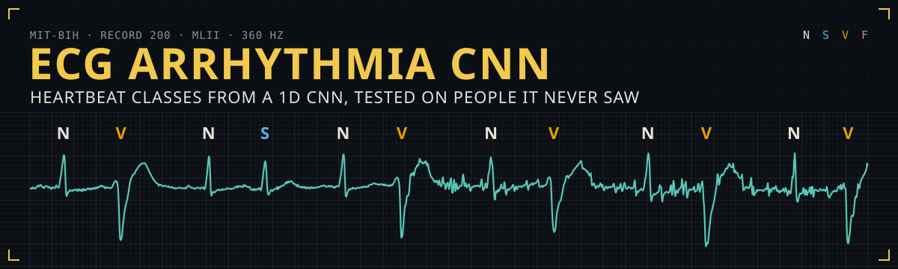

<!-- LIVE -->[](https://github.com/IbaadGEO/ecg-arrhythmia-cnn/releases/tag/v2.0)    [](DATA-LICENCES.md) [](LICENSE)

**[The question](#the-question)** · **[The explorer](#the-explorer)** · **[Inside the model](#inside-the-model)** · **[Results](#results)** · **[v1 against v2](#v1-against-v2)** · **[Run it](#run-it)**


</div>

> [!NOTE]
> A self-directed learning project covering coding, data, machine learning and geoscience. It is not a professional or commissioned study, and it is **not a medical device**. It uses only published, citable public data: the MIT-BIH Arrhythmia Database and its reference annotations. All results come from code and outputs in this repository, and the first version is kept with its errors documented in [historical/v1](historical/v1/README.md).

<div align="center">

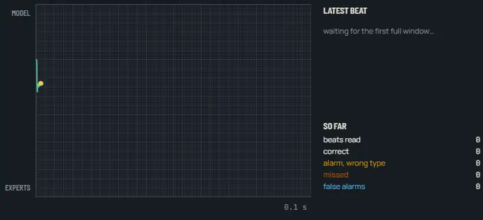

<sub>The explorer's live monitor on record 200, a person the model never saw. Each label appears once the model has the whole window and the next beat. Outlined labels are alarms; the side panel counts correct calls, misses and false alarms as they happen.</sub>

</div>

## The question

<table>
<tr>
<td width="50%" valign="top">

**The data.** Each heartbeat on an electrocardiogram (ECG) produces a sharp QRS complex whose peak, the R peak, marks the beat's position. The MIT-BIH Arrhythmia Database holds 48 half-hour, two-channel recordings from 47 subjects studied between 1975 and 1979. Automatic beat labels were reviewed independently by two cardiologists (Moody and Mark, 2001; 2005). AAMI EC57 groups the labels into N, S (supraventricular ectopic), V (ventricular ectopic) and F (fusion) (AAMI, 2012).

</td>
<td width="50%" valign="top">

**The trap.** About 9 in 10 beats are N, so always answering N scores about 90% accuracy and finds nothing. de Chazal, O'Dwyer and Reilly (2004) split the 44 non-paced recordings into DS1 and DS2 so models are tested on unseen recordings; they reached 75.9% sensitivity and 38.5% positive predictivity for S beats. Records 201 and 202 share a subject (Moody and Mark, 2005), but that split puts them on opposite sides.

</td>
</tr>
</table>

> [!IMPORTANT]
> **Does class-weighted cross-entropy raise per-class recall on the rare S, V and F beats, compared with plain cross-entropy, for people the model was not trained on?**

<picture>
  <source media="(prefers-color-scheme: dark)" srcset="docs/media/flow-dark.svg">
  
</picture>

| | |
|---|---|
| **Train** | 4 configurations (CNN or CNN + RR features, plain or class-weighted loss) × seeds 0, 1, 2, on 16 recordings. Early stopping, model choice and the alarm threshold use 6 validation recordings. |
| **Test** | 21 recordings, 47,532 beats, from subjects never seen in training or validation. A record-to-subject map enforces this, and a unit test covers it. |
| **Report** | Recall, precision and F1 per class, macro F1, balanced accuracy, abnormal-flag recall and precision, N-group false-alarm rate and per-patient results, all with counts. |
| **Uncertainty** | Spread across seeds, and 95% intervals from resampling test patients 2,000 times. |
| **Scope** | Beats are classified at the annotated positions; there is no beat detector. RR features use the next beat and the recording's mean RR, so the pipeline is offline. The explorer's monitor replays in real time, but each label still waits for the next beat. |

## The explorer

<!-- LIVE2 -->A Streamlit app that opens any of the 16 saved checkpoints (12 from the current run, 4 from v1) on any recording its model never saw, and shows how the model reaches each answer.

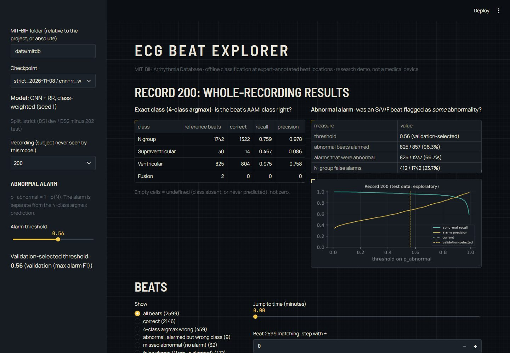

| You choose | You get |
|---|---|
| Data folder, checkpoint, recording, alarm threshold | Only recordings whose subject the chosen model never saw. Missing recordings download from PhysioNet on first use. |
| A threshold | Whole-record tables and a recall and precision against threshold chart. 0.56 is the validated value; anything else is marked exploratory. |
| A beat filter | All, correct, wrong 4-class guess, alarm with the wrong type, missed abnormal, false alarm, each with its count. A time slider and a counter step through them. |
| A beat | ±3 s of context with predicted labels above and reference labels below, the 504-sample model input, probabilities, RR intervals in seconds and as ratios. |
| *Don't get it? See if you get this:* | The same beat in everyday words: a one-line verdict, the experts' label against the model's top guess, and a bar showing how unusual the model rated it against the alarm line. |

<table>
<tr>
<td width="55%" valign="top">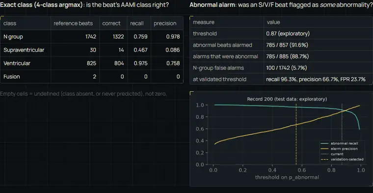<br><b>Moving the alarm threshold.</b> The alarm fires when <i>1 − p(N)</i> reaches the threshold, separately from the 4-class answer. At 0.56 on record 200, 825 of 857 abnormal beats are alarmed and 412 of 1,742 N-group beats raise false alarms (23.7%).</td>
<td width="45%" valign="top"><br><b>A missed V beat, explained twice.</b> The technical readout, then the plain-language panel. It calls the outputs scores, not confidence, because the softmax outputs are not calibrated.</td>
</tr>
</table>

The theme is dark, with a faint ECG-paper grid and flat ruled panels. Beat classes use Okabe–Ito colours, which stay distinct for the common forms of colour blindness: N off-white, S sky blue, V orange, F reddish purple. Shape-only checkpoints (no RR features) hide the timing parts of the explanation. The v1 checkpoints have no validation-selected threshold, so they open at 0.50 with a warning that the value is arbitrary.

## Inside the model

The explorer's last section walks through the network on whichever beat is selected. It opens with the live monitor shown above, replaying 20 s around that beat, then five steps, each with an animated diagram drawn from the checkpoint's real weights and activations and a *try it yourself* panel to change the input and watch the answer move.

<table>
<tr>
<td width="50%"><br><b>Pattern detectors.</b> One of the 32 first-layer filters slides along the 504-sample window. The inset shows the 7 samples under it, its 7 learned weights and the output after the learned scaling and ReLU. You can also build a detector from 7 weight sliders and watch it run on the same beat.</td>
<td width="50%">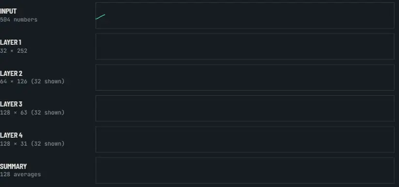<br><b>Bigger patterns.</b> The four convolution blocks as heatmaps, each half as long as the one before (504, 252, 126, 63, 31 positions), then averaged into 128 numbers. A slider follows any one of those numbers back to where it responds along the beat and shows how hard it pushes each class.</td>
</tr>
<tr>
<td>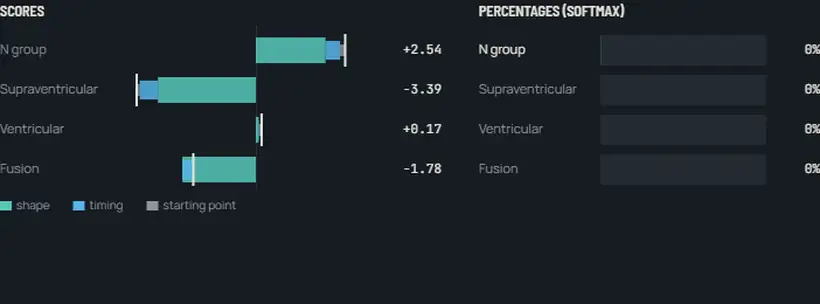<br><b>The decision.</b> Each class score is split exactly into a shape part (the 128 numbers), a timing part (the 4 RR features) and a bias, then passed through softmax. Switching either part off shows how much it contributes for this beat. A table gives the exact values.</td>
<td>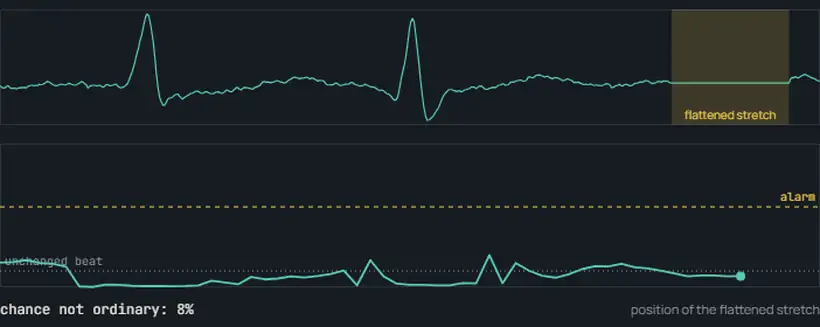<br><b>What it relies on.</b> A flattened stretch slides across the beat and the curve records the model's answer at each position; on this missed V beat it stays far below the alarm line. A second sweep stretches the gap before the beat from 0.3× to 2× the average, and manual controls do either by hand.</td>
</tr>
</table>

The first step, *What goes in*, animates the 1.4 s window being cut out of the recording and rescaled: changing the trace's height or baseline makes no difference after rescaling, while moving the window off the beat does. The edited beats are not real recordings, so they describe this model, not hearts. Every diagram has play and replay buttons and starts paused when the system asks for reduced motion.

## Results

Strict split, 21 test recordings, 3 seeds. Mean ± sd across seeds, then the 95% patient-cluster bootstrap CI in brackets. Per-class recall (%), 4-class argmax. Every count is in [runs/strict_2026-11-08/summary.md](runs/strict_2026-11-08/summary.md).

| Config | N group | S | V | F |
|---|---|---|---|---|
| CNN, plain | 87.9 ± 5.4 [79.9, 94.5] | 0.4 ± 0.2 [0.3, 1.7] | 90.4 ± 3.0 [80.1, 95.6] | 6.1 ± 10.6 [0.0, 7.7] |
| CNN, weighted | 82.4 ± 11.0 [75.6, 89.1] | 3.2 ± 1.8 [0.8, 16.0] | 83.5 ± 3.7 [68.0, 92.7] | 17.9 ± 26.2 [0.0, 18.8] |
| CNN+RR, plain | 86.0 ± 6.0 [77.2, 93.2] | 2.2 ± 1.5 [0.5, 10.7] | 92.2 ± 2.6 [82.7, 96.6] | 0.4 ± 0.7 [0.0, 0.5] |
| CNN+RR, weighted | 87.1 ± 3.7 [80.9, 93.1] | 3.4 ± 1.3 [0.6, 16.3] | 85.7 ± 6.4 [71.6, 93.5] | 12.1 ± 20.4 [0.0, 12.9] |

> [!IMPORTANT]
> **Class weighting did not reliably improve rare-class recall under this protocol.** S recall stayed below 4% on average in every configuration. F recall rose on average, but 9 of the 12 runs scored 5.4% or less and the mean is driven by seed 1. V recall fell by about 7 points with weighting. RR features showed no consistent advantage either.

The validation-selected model (CNN + RR, class-weighted, seed 1, threshold 0.56) alarmed on 3,429 of 5,369 abnormal test beats (63.9%). 3,429 of its 9,097 alarms were real (37.7%), and 5,668 of 42,163 N-group beats raised false alarms (13.4%).

## v1 against v2

Both demo excerpts show the same stretch of record 200 (966–974 s). The [v2.0 release](https://github.com/IbaadGEO/ecg-arrhythmia-cnn/releases/tag/v2.0) holds the full videos, recorded before the explorer's current theme.

<table>
<tr>
<td width="50%">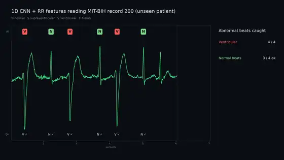<br><b>v1 demo.</b> CNN + RR, plain loss, trained on all 22 DS1 recordings with one seed and no validation set. Over the whole of record 200 it flags 816 of 857 abnormal beats and 162 of 1,742 N-group beats (9.3%). It does not label false alarms on screen.</td>
<td width="50%">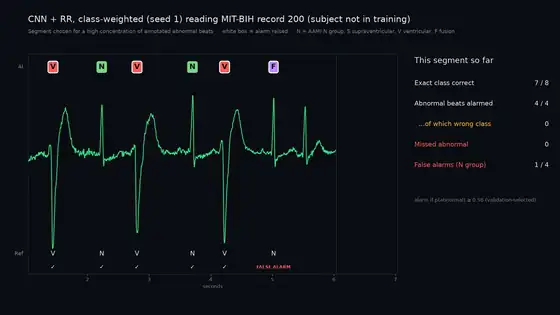<br><b>v2 demo.</b> The validation-selected model at threshold 0.56. Over the whole recording it alarms on 825 of 857 abnormal beats and on 412 of 1,742 N-group beats (23.7%). Every false alarm and miss is labelled. A single recording is not enough to compare the two protocols.</td>
</tr>
<tr>
<td>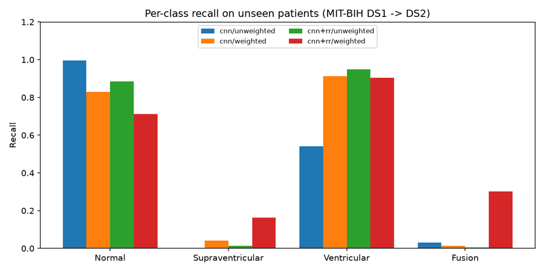<br><b>v1 recall.</b> One seed. The patient split is the conventional DS1/DS2, which shares subject 201/202; the beat split mixes beats from the same patients and overlapping windows.</td>
<td>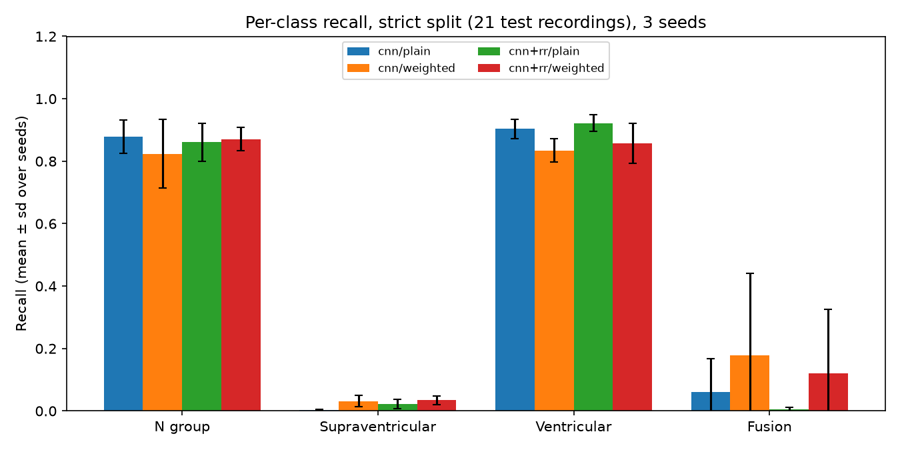<br><b>v2 recall.</b> Strict split, mean ± sd over 3 seeds. The v1 result "weighting raises V recall from 54% to 91%" does not reappear.</td>
</tr>
</table>

<sub>ECG and reference labels: MIT-BIH Arrhythmia Database, record 200 (Moody and Mark, 2005), ODC-By 1.0. Excerpts cut from the demo videos and re-encoded as animated WebP at 8 fps. The demo videos come from `demo.py`, which keeps its own video layout.</sub>

## Where each part comes from

| Part | Status | Source |
|---|---|---|
| ECG signals, MLII lead, 360 Hz | Observed (recorded 1975–1979) | Moody and Mark (2001, 2005) |
| Beat positions and beat labels | Reported (automatic labels, reviewed by two cardiologists) | Moody and Mark (2005) |
| Records 201 and 202 from the same subject | Reported | Moody and Mark (2005) |
| N, S, V, F grouping of the labels | Standard, applied by this project | AAMI (2012) |
| Beat windows and RR-interval features | Derived by this project | `ecgcnn/data.py` |
| Model probabilities, predictions and alarms | Model output | this project |
| Filter outputs, layer activations and score parts in the explorer | Model internals, read from the checkpoint | `ecgcnn/explain.py` |
| Answers for flattened, shifted or re-timed beats | Model output on edited inputs, not recordings | `ecgcnn/explain.py` |
| Recall, precision, F1, flag metrics, per-patient results | Computed against the reference labels | this project |
| Confidence intervals | Estimated (patient-cluster bootstrap) | this project |
| Alarm threshold 0.56 and the selected model | Chosen on validation recordings | this project |

Every ECG trace and reference label shown here, including the banner, comes from the MIT-BIH Arrhythmia Database (Moody and Mark, 2005), under the Open Data Commons Attribution License v1.0. The recordings themselves are not included; they download from PhysioNet. The README media are screen recordings of this project's explorer, excerpts of its demo videos and its own plots and diagrams, cropped, resized, re-timed and re-encoded as WebP, JPEG, PNG and SVG. No other authors' figures or outputs are reproduced.

The explorer and the README graphics use three fonts from `static/fonts/`, each under the SIL Open Font License 1.1 with its licence file alongside: [Manrope](https://github.com/sharanda/manrope) by The Manrope Project Authors, [Barlow Semi Condensed](https://github.com/jpt/barlow) by The Barlow Project Authors, and [JetBrains Mono](https://github.com/JetBrains/JetBrainsMono) by The JetBrains Mono Project Authors. The banner and figures strip embed Barlow Semi Condensed and JetBrains Mono.

## Run it

<!-- LIVE3 -->The explorer runs from the saved checkpoints with no training. Install, data, hosting, retraining, the demo video and the code layout are below.

Full walkthrough of the code and protocol: [WALKTHROUGH.md](WALKTHROUGH.md) · v1 baseline and its corrections: [historical/v1/README.md](historical/v1/README.md) · Terms per file: [DATA-LICENCES.md](DATA-LICENCES.md)

<details>
<summary><b>Install, run, retrain, render</b></summary>

### Install

Tested on Windows 11 with Python 3.13.7 and an RTX 3060 Ti. Versions are pinned in `requirements.txt`. On Linux it installs the CPU-only PyTorch build; for GPU training on Linux, install the CUDA build first and remove the `+cpu` line.

```bash
python -m venv .venv
.venv/Scripts/pip install torch==2.14.1 --index-url https://download.pytorch.org/whl/cu126   # CPU: pip install torch==2.14.1
.venv/Scripts/pip install -r requirements.txt
```

Training needs the whole MIT-BIH Arrhythmia Database v1.0.0: download it from https://physionet.org/content/mitdb/1.0.0/ and unzip it so the record files sit in `data/mitdb/` (for example `data/mitdb/100.hea`, `100.dat`, `100.atr`). The explorer does not need this step. When a recording it is asked for is missing, it downloads that recording's three files (about 2 MB) from PhysioNet into the same folder.

### Explore the saved models (no training needed)

Run from the repository root, so Streamlit finds `.streamlit/config.toml` (theme, fonts, usage statistics off):

```bash
.venv/Scripts/streamlit run explorer.py
```

After editing files in `ecgcnn/`, restart the server; Streamlit keeps the imported package in memory.

### Host the explorer on Streamlit Community Cloud (free)

The repository is set up for it: the checkpoints are committed, recordings download on first use, Linux gets the CPU-only PyTorch build, and the theme and fonts load from `.streamlit/config.toml` and `static/`. On share.streamlit.io, create an app from this repository's `main` branch with `explorer.py` as the main file, and pick Python 3.13 in the advanced settings if it is offered.

The free tier allows roughly 0.7 to 2.7 GB of memory; the explorer used about 0.75 GB locally, and it caches at most 4 recordings at a time. Apps sleep after 12 hours without visitors and wake on the next visit, and each recording takes a few seconds to download the first time it is opened.

### Retrain and evaluate

```bash
.venv/Scripts/python -m pytest                                  # 28 unit tests
.venv/Scripts/python run_experiments.py --out runs/my_run       # 4 configs x 3 seeds, about 5 min on an RTX 3060 Ti
.venv/Scripts/python summarize.py runs/my_run                   # writes runs/my_run/summary.md
```

`run_experiments.py` refuses to overwrite an existing run directory. Each run records its records per partition, seeds, hyperparameters and software versions in `config.json`. CUDA training is seeded and set to deterministic mode where PyTorch allows it; some kernels remain nondeterministic, so reruns can differ slightly.

### Render a demo video

Needs `ffmpeg` on PATH. The script refuses any recording whose subject the checkpoint saw in training or validation.

```bash
.venv/Scripts/python demo.py --checkpoint runs/strict_2026-11-08/checkpoints/cnn+rr_weighted_seed1.pt --record 200
.venv/Scripts/python demo.py --checkpoint historical/v1/results/cnn+rr_unweighted.pt --legacy --record 200 --out v1_check.mp4
```

### Code layout

| Path | Role |
|---|---|
| `ecgcnn/data.py` | record-to-subject map, splits, AAMI labels, RR features, windows, input checks, on-demand record download |
| `ecgcnn/model.py` | 1D CNN, self-describing checkpoints, explicit `legacy=True` loading for v1 files |
| `ecgcnn/train.py` | seeded training with validation early stopping |
| `ecgcnn/metrics.py` | confusion-matrix metrics (undefined values kept as undefined), alarm metrics, patient bootstrap |
| `ecgcnn/inference.py` | per-record inference, beat status, subject-based eligibility |
| `ecgcnn/explain.py` | layer outputs, exact score split, edited-input sweeps and plain-language summaries for the explorer |
| `ecgcnn/live.js` | the explorer's animated canvas diagrams |
| `.streamlit/config.toml`, `observatory.mplstyle`, `static/fonts/` | explorer theme, matching plot style, self-hosted fonts |
| `run_experiments.py`, `summarize.py`, `demo.py`, `explorer.py` | entry points |

### Limitations

- Beat positions come from the reference annotations; there is no beat detector.
- RR features use the next beat and the whole-recording mean, so the pipeline is offline only.
- The AAMI N group includes bundle branch block and escape beats, so it is broader than normal sinus rhythm.
- The validation partition is small and fixed (30 F beats). There is no cross-validation.
- Test classes are concentrated: record 232 holds 1,382 of 1,782 S beats, and record 213 holds 362 of 387 F beats.
- DS2 results had been inspected during v1, so DS2 is not an untouched holdout.
- The explorer's edited-input experiments (flattening, shifting, re-timing) probe one checkpoint on inputs it never trained on. They show what that model responds to, not how hearts behave.


</details>

<details>
<summary><b>Built with</b></summary>

- Model and training: Python 3.13, PyTorch 2.14 (CUDA 12.6), NumPy, and scikit-learn for class weights.
- Data access: wfdb 4.3.1 reads the PhysioNet records and annotations.
- Evaluation and plots: the project's own confusion-matrix metrics and patient bootstrap, and matplotlib with a shared dark style (`observatory.mplstyle`).
- Explorer: Streamlit 1.67, themed through `.streamlit/config.toml`. The live diagrams are plain canvas JavaScript (`ecgcnn/live.js`) mounted with `st.components.v2`, so they render in the page and use the same fonts.
- Demo video: matplotlib with ffmpeg. The README media were recorded with Playwright (headless Chromium) and assembled with Pillow; the banner and figures strip are SVG drawn from record 200.
- Tests: 28 pytest tests covering subject separation, label mapping, RR features, metrics, checkpoint loading, on-demand record download and the explorer's model explanations (for example, that the shape, timing and bias parts add up to the model's own scores).

</details>

<details>
<summary><b>References</b></summary>


**Research papers**

- de Chazal, P., O'Dwyer, M. and Reilly, R.B. (2004) 'Automatic classification of heartbeats using ECG morphology and heartbeat interval features', *IEEE Transactions on Biomedical Engineering*, 51(7), pp. 1196–1206. doi:10.1109/TBME.2004.827359.
- Kachuee, M., Fazeli, S. and Sarrafzadeh, M. (2018) 'ECG heartbeat classification: a deep transferable representation', *2018 IEEE International Conference on Healthcare Informatics (ICHI)*, pp. 443–444. doi:10.1109/ICHI.2018.00092.
- Moody, G.B. and Mark, R.G. (2001) 'The impact of the MIT-BIH Arrhythmia Database', *IEEE Engineering in Medicine and Biology Magazine*, 20(3), pp. 45–50. doi:10.1109/51.932724.

**Data and standards**

- AAMI (2012) *ANSI/AAMI EC57:2012 Testing and reporting performance results of cardiac rhythm and ST segment measurement algorithms* (reaffirmed 2020). Arlington, VA: Association for the Advancement of Medical Instrumentation. doi:10.2345/9781570204784.
- Moody, G. and Mark, R. (2005) *MIT-BIH Arrhythmia Database* (version 1.0.0). PhysioNet. doi:10.13026/C2F305.
- Pollard, T., Moody, B.E., Lehman, L.H., Gow, B.J., Fernandes, C., Xie, C., Johnson, A., Mark, R.G. and Heldt, T. (2026) 'PhysioNet as a global platform for biomedical research', *Nature Health*, 1(8), pp. 792–795. doi:10.1038/s44360-026-00096-z.

**Software**

- Paszke, A. et al. (2019) 'PyTorch: an imperative style, high-performance deep learning library', *Advances in Neural Information Processing Systems 32 (NeurIPS 2019)*. arXiv:1912.01703, doi:10.48550/arXiv.1912.01703.
- Pedregosa, F. et al. (2011) 'Scikit-learn: machine learning in Python', *Journal of Machine Learning Research*, 12(85), pp. 2825–2830.
- Xie, C., McCullum, L., Johnson, A., Pollard, T., Gow, B. and Moody, B. (2023) *Waveform Database Software Package (WFDB) for Python* (version 4.1.0). PhysioNet. doi:10.13026/9njx-6322. (Version 4.3.1 from PyPI was used.)

Accessed 9 November 2026. Kachuee, Fazeli and Sarrafzadeh (2018) is the source of the pre-segmented Kaggle version of MIT-BIH. It was not used here because its rows hold 187 samples and a label but no record identifier, so it cannot be split by patient.

</details>

## Licence

Code: [MIT](LICENSE). Fonts in `static/fonts/`: SIL Open Font License 1.1. The ECG data and reference labels keep the MIT-BIH Arrhythmia Database's terms (Open Data Commons Attribution License v1.0); see [DATA-LICENCES.md](DATA-LICENCES.md). The animations and images in `docs/media/` are recordings and excerpts of this project's outputs that show MIT-BIH data, shared under the same attribution terms.
